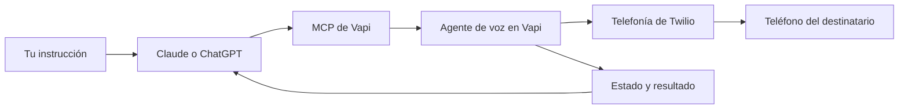

# Agentes que llaman por teléfono mediante MCP

Guía práctica, paso a paso y en español para conectar un número telefónico a **Claude o ChatGPT** y ordenar llamadas a un agente de voz.

**Ruta principal:** Twilio + Vapi + MCP oficial de Vapi. No necesitas programar tu propio servidor MCP para empezar. El repositorio incluye instrucciones, plantillas y una herramienta de diagnóstico; **clonarlo no compra un número, no conecta tus cuentas y no realiza llamadas**.

Documentación consultada: **9 de noviembre de 2026**. Las interfaces, permisos y disponibilidad por país pueden cambiar. Los ejemplos son una propuesta de implementación, no una integración desplegada en tus cuentas.

## 1. Entiende qué estás conectando



| Pieza | Función | Ejemplo |
|---|---|---|
| Claude / ChatGPT | Interpreta la orden y usa herramientas | «Llama una vez a mi número de prueba» |
| MCP | Permite descubrir y ejecutar herramientas | `list_assistants`, `create_call` |
| Vapi | Ejecuta la conversación de voz | Escucha, responde, interrumpe y termina |
| Twilio | Conecta con la red telefónica | Número de salida y minutos |
| Número destino | Recibe la llamada | Tu celular para la primera prueba |

**El número de salida y el celular al que llamas son datos distintos.** MCP no controla una SIM por escribir su número. Un número Twilio importado es la ruta documentada; conservar tu móvil actual requiere revisar portabilidad, desvío o identificador verificado. [Opciones del número actual](docs/07-numero-actual-y-whatsapp.md).

**El agente que habla por teléfono no es automáticamente la conversación que tienes abierta en Claude o ChatGPT.** Aquí el chat da la orden y el agente configurado en Vapi habla. Su modelo, voz, instrucciones y herramientas se configuran por separado. [Cómo se expone Vapi mediante MCP](https://docs.vapi.ai/sdk/mcp-server).

## 2. Sigue esta ruta, en orden

| Paso | Guía | Qué debe quedar comprobado |
|---|---|---|
| 1 | [Número y telefonía](docs/01-numero-y-telefonia.md) | Tienes un número con capacidad de voz y permisos al destino |
| 2 | [Crear el agente de voz](docs/02-agente-de-voz.md) | Habla español y puede llamar desde el panel |
| 3A | [Conectar Claude](docs/03-conectar-claude.md) | Claude consulta tus asistentes y números |
| 3B | [Conectar ChatGPT](docs/04-conectar-chatgpt.md) | ChatGPT descubre herramientas mediante el túnel |
| 4 | [Primera llamada y resultado](docs/06-primera-llamada.md) | Una llamada a tu número propio; identificador y estado verificados |
| 5 | [Costos y diagnóstico](docs/08-costos-y-diagnostico.md) | Sabes dónde revisar errores y cobros |
| 6 | [Operación, CRM y límites](docs/09-operacion-y-crm.md) | Tienes límites y seguimiento antes de automatizar |

**Elige 3A o 3B. No tienes que configurar ambos.** Para una primera prueba desde escritorio, comienza por Claude. Para ChatGPT, lee primero los requisitos de MCP personalizado y Secure MCP Tunnel en su guía; no compres un plan suponiendo que tendrá una opción sin comprobarlo.

Si quieres construir una aplicación propia con modelos de OpenAI, sigue [la ruta API](docs/05-openai-api.md). Es diferente de conectar la aplicación ChatGPT.

## 3. Cuentas y datos que necesitas

| Dato | De dónde sale | Dónde se usa |
|---|---|---|
| Número de salida | Twilio, comprado o portado si es elegible | Se importa en Vapi |
| Account SID y Auth Token de Twilio | Twilio Console | Formulario de importación de Vapi |
| `assistantId` | Asistente publicado en Vapi | Orden de llamada |
| `phoneNumberId` | Registro del número dentro de Vapi | Orden de llamada |
| Clave privada Vapi | API Keys de Vapi | Cliente MCP o herramienta local |
| Número propio de prueba | Tu teléfono | Destino de una prueba autorizada |
| `tunnel_id` y clave runtime OpenAI | Solo ruta ChatGPT con túnel | Cliente de túnel |

Los identificadores no sustituyen las claves. **`phoneNumberId` es el ID de Vapi, no el teléfono `+57...` ni el SID `PN...` de Twilio.** En los ejemplos, reemplaza los marcadores completos por tus datos.

### No subas las claves

Copia las plantillas a la carpeta local `private/`, ignorada por Git. No publiques claves, números de clientes, grabaciones ni transcripciones. Las claves privadas Vapi pueden acceder a toda su organización: utiliza una organización de pruebas cuando sea posible. [Gestión de API keys](https://docs.vapi.ai/security-and-privacy/api-keys).

El archivo [.env.example](.env.example) describe las variables, pero **Python no carga `.env` automáticamente**. Este repositorio usa variables de entorno o entrada local oculta; cada guía indica cómo hacerlo.

## 4. Descargar y comprobar los ejemplos

Necesitas Python **3.10 o posterior** para la herramienta de diagnóstico; usa `python3` en macOS/Linux o `py -3` en Windows. No requiere paquetes externos.

```bash
git clone https://github.com/Samuelacuna12/guia-agentes-llamadas-mcp.git
cd guia-agentes-llamadas-mcp
python3 scripts/vapi_phone.py --help
python3 -m unittest discover -s tests -v
```

Repositorio privado: para clonarlo debes iniciar sesión en GitHub con acceso a esta cuenta. También puedes usar **Code → Download ZIP**, extraerlo y abrir una terminal dentro de la carpeta. Si usas Windows, sustituye `python3` por `py -3` en los ejemplos.

Una simulación **sin red y sin clave**:

```bash
python3 scripts/vapi_phone.py create-call \
  --assistant-id REEMPLAZAR_ASSISTANT_ID \
  --phone-number-id REEMPLAZAR_PHONE_NUMBER_ID \
  --to +12025550123
```

El número mostrado es un ejemplo con formato internacional; **no lo uses para ejecutar una llamada**. Sin `--execute` se muestra el cuerpo de la solicitud y no se contacta a Vapi. Para llamar de verdad se exigen destino autorizado, lista local de números de prueba y confirmación del destino: [instrucciones completas](docs/06-primera-llamada.md).

## 5. Qué incluye cada carpeta

```text
docs/       Tutoriales y diagnóstico en español
examples/   Configuración de Claude, túnel ChatGPT y API de OpenAI
prompts/    Instrucciones del agente de voz y del operador MCP
scripts/    Herramienta REST de prueba con simulación por defecto
tests/      Pruebas locales sin llamadas ni credenciales
private/    Tus configuraciones reales; ignoradas por Git
```

## 6. Límites y estado de verificación

- Verificamos documentación oficial y el comportamiento local de los ejemplos con respuestas simuladas.
- No configuramos cuentas de Twilio, Vapi, Claude ni ChatGPT, ni hicimos llamadas reales. Completa [la lista de aceptación](docs/10-lista-de-aceptacion.md) para comprobar tu instalación.
- La ruta ChatGPT combina capacidades documentadas de OpenAI y Vapi. Su funcionamiento en una cuenta concreta depende de permisos, disponibilidad y prueba de extremo a extremo.
- Los números gratuitos de Vapi se documentan actualmente como solo entrantes; para llamar usa un número importado. [Llamadas salientes](https://docs.vapi.ai/calls/outbound-calling).
- Los prompts ayudan al comportamiento, pero no sustituyen controles del servidor. La lista permitida del script solo protege ese script; **no limita el MCP oficial de Vapi**.
- Para campañas, verifica consentimiento, horarios y reglas aplicables al país de origen y de destino. Comienza con tu propio número y una sola llamada.

Consulta [fuentes oficiales y fecha de revisión](docs/11-fuentes.md). No se incluyen tarifas fijas ni promesas de compatibilidad con cualquier SIM o país.
